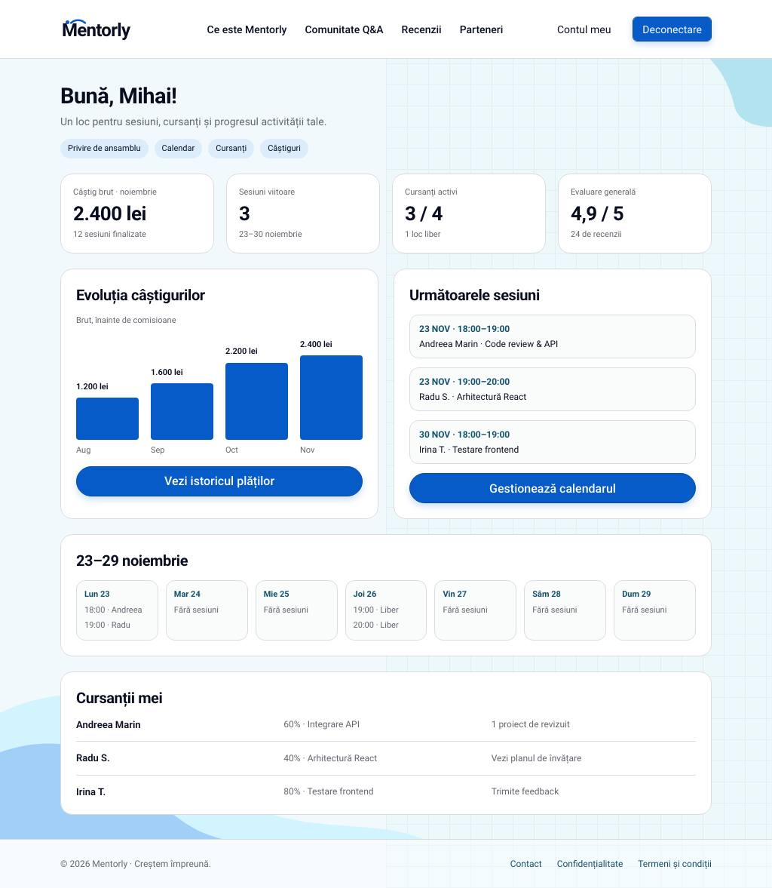
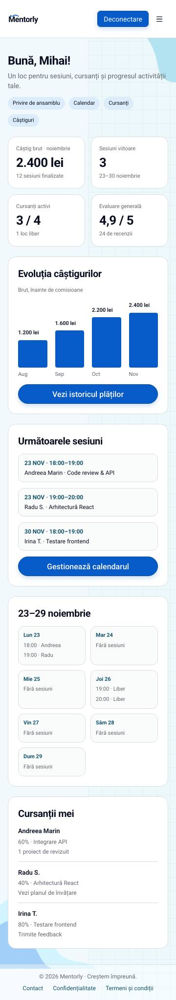

## feat(mentor): mentor dashboard (`/mentor`)

## What & why

Phase E, step E3, FE only: the mentor dashboard from the Figma screen **17 · Dashboard mentor**, on `/mentor` (it replaces the placeholder). „Contul meu” in the mentor account now leads here.

Built in small steps, one commit each:

| Step | Commit                                                            | What                                                                                                        |
| ---- | ----------------------------------------------------------------- | ----------------------------------------------------------------------------------------------------------- |
| E3.1 | `dashboard sample data, types and bar height helper`              | Sample data (stats, earnings, sessions, week, students) + types                                             |
| E3.2 | `/mentor route with dashboard greeting and section tabs`          | „Bună, Mihai!” + the Privire de ansamblu / Calendar / Cursanți / Câștiguri tabs (they jump to the sections) |
| E3.3 | `dashboard stat cards`                                            | The 4 cards: gross earnings, upcoming sessions, active students, rating                                     |
| E3.4 | `earnings chart with payment history`                             | „Evoluția câștigurilor” chart (Aug–Nov) + „Vezi istoricul plăților” (table, opens / closes)                 |
| E3.5 | `upcoming sessions and weekly overview`                           | „Următoarele sesiuni” + the 23–29 November week                                                             |
| E3.6 | `my students list and remove the unused account placeholder`      | „Cursanții mei” + removal of the placeholder that's no longer used                                          |
| E3.7 | `dashboard review fixes` + `screenshots for the mentor dashboard` | Review fixes + screenshots of this page                                                                     |

## Screenshots

| Desktop                                                                                                                                                                                                | Mobile                                                                                                                                                                                             |
| ------------------------------------------------------------------------------------------------------------------------------------------------------------------------------------------------------ | -------------------------------------------------------------------------------------------------------------------------------------------------------------------------------------------------- |
|  |  |

## Not included (intentionally)

- The other mentor-account screens (application states, profile editing, availability, incoming applications, separate earnings) **have no frames in Figma**. They wait for design.
- Real data and payments: backend.

## How to verify

```bash
npm ci && npm run dev
```

- `/mentor` → compare with the Figma screen 17.
- The tabs at the top → jump to the sections; „Vezi istoricul plăților” → table.

## Checklist

- [x] Lint / typecheck / format / build pass
- [x] Each step checked in the browser (no console errors, no overflow 320–1440)
- [x] Code review + UI/a11y review: fixes in `fix(mentor): dashboard review fixes` (a shared section card with the student profile, a safe first name, amounts formatted as „2.400 lei”, section ids in one place, „Cursanții mei” actions as plain text until they have pages, 2 stats per row on mobile)
- [x] Screenshots (desktop + mobile) of the dashboard, only for this PR
