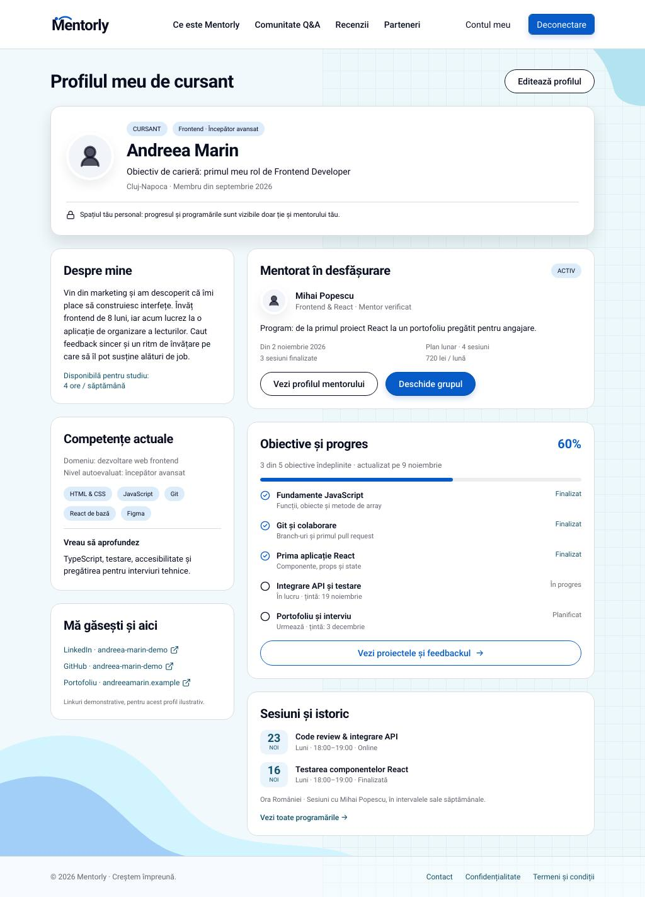
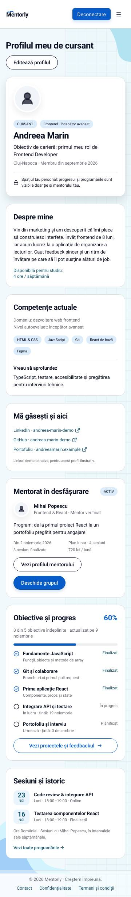

## feat: student profile (`/cursant`)

## What & why

- **Profil cursant** (Figma frame „Profil cursant / utilizator”, tickets SCRUM-316 / SCRUM-319, FE only). The `/cursant` page, so „Contul meu” now leads here. It contains:
  - hero: name, career goal, city, privacy note;
  - „Despre mine”, „Competențe actuale”, „Mă găsești și aici”;
  - „Mentorat în desfășurare” (links to the mentor profile and to Proiectele mele);
  - „Obiective și progres” (60 %, 5 goals);
  - „Sesiuni și istoric”.
- **„Editează profilul”**: an inline form (name, city, goal, „Despre mine”) with zod validation. UI only: the changes stay in the page, with no backend. Figma has no separate frame for settings, so I kept the existing card style.
- **Screenshots** of this page (desktop 1024 + mobile 360) in `docs/screenshots/student-profile/`.
- Small refactor: `ExternalLinkItem` moved to `components/common` (used in both profiles).

## Screenshots

### Profil cursant

| Desktop                                                                                                                                                                                           | Mobile                                                                                                                                                                                        |
| ------------------------------------------------------------------------------------------------------------------------------------------------------------------------------------------------- | --------------------------------------------------------------------------------------------------------------------------------------------------------------------------------------------- |
|  |  |

## Not included (intentionally)

- Saving the profile, the real group / chat: backend.
- Favorites (SCRUM-300): not in Figma.

## How to verify

```bash
npm ci && npm run dev
```

- `/cursant` → compare with the „Profil cursant / utilizator” frame.
- „Editează profilul” → clear the name → „Salvează” → error; fill it in → saved message.

## Checklist

- [x] Lint / typecheck / format / build pass
- [x] Screenshots generated with Playwright (1024 + 360)
- [x] Code review + UI/a11y review: fixes in `fix: student profile review fixes` (focus after opening/saving the form, the name as a heading, a named form, limits and texts derived from the data, shared link style)
